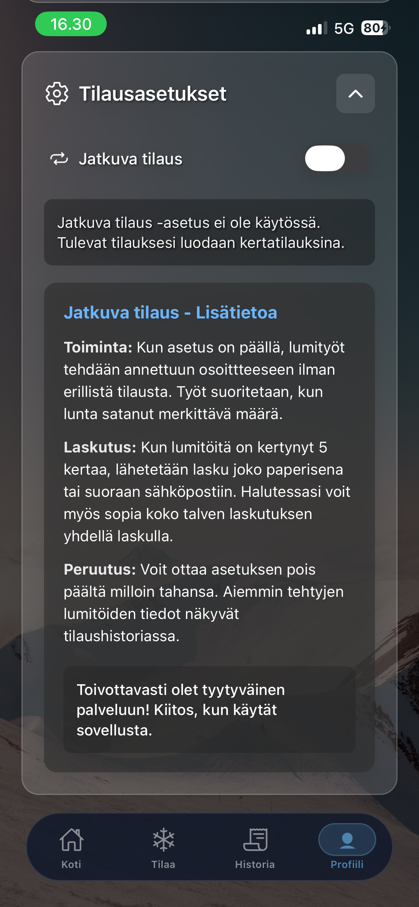

<div align="center">

<!-- Replace with your actual header image -->


<br/>

**Snow clearing, on-demand. Built for Finnish winters.**


</div>


---

## What is this?

**Lumityö-tilaus** is a mobile app for ordering professional snow clearing services in Finland. Customers can place one-time or recurring orders for snow removal and ice clearing directly from their phone, with real-time address lookup.

---

## Screenshots

| | | |
|:---:|:---:|:---:|
|  |  |  |

---

## Features

- **❄️ Snow clearing order** — one-tap order for your address
- **🧊 Ice removal** — Polanteen poisto service
- **🔁 Jatkuva tilaus** — recurring automatic service, activated once, runs every snowfall
- **📍 Current location** — optionally find an order address using the device's foreground location and address lookup; the search can be cancelled, and the address should be checked before ordering
- **🔔 Free first order** — new users get their first order free
- **📋 Order history** — track past orders and their statuses synced from Supabase
- **Order guidance** — required fields show specific errors, successful orders show a confirmation, and history provides retry or order actions where appropriate
- **Oulu weather forecast** — a compact three-day home-screen widget shows the nearest forecast for today and forecasts around noon for the next two days. A snowflake indicates forecast snowfall at any available hour of the day (for today, the current or upcoming hours); tap a day to see the forecast hours. It uses [Finnish Meteorological Institute open data](https://en.ilmatieteenlaitos.fi/open-data) under [CC BY 4.0](https://creativecommons.org/licenses/by/4.0/). These are forecasts, not observations; no customer location is used. The device connects directly to FMI, which receives its IP address.
- **👤 Profile details** — contact details can be cleared or left incomplete after disabling any continuous order; existing orders retain their own contact details
- **📧 Contact form** — send messages directly via EmailJS
- **Privacy information** — the profile's privacy button is temporarily hidden. Customers can still use the contact form to send a data request; the business must verify and handle it.
- **📱 Cross-platform** — iOS and Android via Expo

The in-app summary is not a complete privacy notice. Before release, the business must provide an approved notice covering its actual data practices and establish a process for handling deletion requests.

---

## Tech Stack

| Layer | Tech |
|-------|------|
| Framework | React Native + Expo SDK 54 |
| Backend | Supabase (Postgres + REST API) |
| Address Autocomplete | Mapbox Geocoding + OpenCage |
| Email | EmailJS |
| Navigation | React Navigation (Bottom Tabs) |
| Storage | AsyncStorage + Supabase |

---

## Getting Started

### Prerequisites

- Node.js 18+
- Expo CLI (`npm install -g expo-cli`)
- An [EAS account](https://expo.dev) for builds

### Install

```bash
git clone https://github.com/thahertech/Lumityo-tilaus.git
cd Lumityö-tilaus-app
npm install
```

### Environment variables

Create a `.env` file in the root of `Lumityö-tilaus-app/`:

```env
EXPO_PUBLIC_SUPABASE_URL=your_supabase_project_url
EXPO_PUBLIC_SUPABASE_ANON_KEY=your_supabase_anon_key
EXPO_PUBLIC_EMAILJS_SERVICE_ID=your_emailjs_service_id
EXPO_PUBLIC_EMAILJS_TEMPLATE_ID=your_emailjs_template_id
EXPO_PUBLIC_EMAILJS_USER_ID=your_emailjs_user_id
EXPO_PUBLIC_MAPBOX_ACCESS_TOKEN=your_mapbox_token
EXPO_PUBLIC_OPENCAGE_API_KEY=your_opencage_key
```

> ⚠️ Never commit `.env` — it is gitignored.

Production EAS builds use the `production` environment configured in Expo. Set all the variables listed above there; do not add literal `$EXPO_PUBLIC_...` references to the production build profile.

### Run

```bash
npx expo start
```

Press `i` for iOS simulator, `a` for Android emulator, or scan the QR with Expo Go.

The current-location option requires device location permission. Native builds must be rebuilt after adding or changing the location permission configuration.

Native splash screen settings are in `app.json`; changes require a new native build. Check the splash screen in a release build, since Expo Go and development builds may display it differently.

The internal Expo project name is ASCII to keep EAS and Xcode target names consistent. The installed app displays “Lumityöt” on both iOS and Android.

---

## Project Structure

```
Lumityö-tilaus-app/
├── screens/
│   ├── HomeScreen.js          # Landing + animated CTA
│   ├── OrderScreen.js         # Order creation form
│   ├── OmatTiedotScreen.js    # User profile + jatkuva tilaus + history
│   └── ExtraScreen.js         # Info & extras
├── components/
│   ├── OrderMapPreview.js     # Reusable map component (not used by the order form)
│   └── AddressAutocompleteMapboxNew.js
├── Navigation/
│   └── AppNavigator.js        # Floating transparent tab dock
├── utils/
│   └── OrderHistoryUtils.js   # History sync with Supabase
├── SupabaseAPI.js             # All Supabase queries
├── FreeOrderUtils.js          # Free order eligibility logic
├── app.config.js              # Expo config + env passthrough
└── .env                       # 🔒 Secret credentials (gitignored)
```

---

## Services

| Service | Price estimate |
|---------|---------------|
| Lumityö (snow clearing) | 10–20 € |
| Polanteen poisto (ice removal) | 20–30 € |

---

## Security

- All API keys and credentials are stored in `.env` — never in source code
- `.env` is gitignored
- Supabase anon key is scoped with row-level security (RLS)

### Lumityöpaketti (under development)

The proposed package is not available for purchase. The development-only migration defines purchases, a credit ledger, a receipt outbox, authenticated balance and order-reservation functions, and service-only completion and restoration functions. The `package-checkout` and `package-receipt-worker` Edge Functions are disabled by default; the Paytrail callback checks the signed transaction before issuing credits. New package sessions use Supabase anonymous authentication instead of an email verification code. Customers enter an email for the payment receipt, but it is not verified or used for account recovery. The package is tied to the anonymous session stored on that device.

**Do not apply the package migrations, deploy the functions, or enable payment, cancellation or receipts in production yet.** The customer screen implements email verification, balance, checkout handoff, customer-facing terms and individual package orders. The terms have not been legally approved. Map and Pro integrations implement work-device approval, package completion, linked visits and invoice filtering, but are incomplete and have not been tested end-to-end against Supabase. In particular Map's next-round bulk workflow is not integrated; server-enforced free-first-order precedence, recurring package orders, payment reconciliation, receipt scheduling and operational recovery remain incomplete. Existing order policies and the live schema must also be assessed. Reservation makes a credit unavailable when an order is placed; a trusted completion must record the completed round once, and restoration is a case-by-case staff action.

On iOS or Android, the package offer appears on the Tilaa screen in development builds. A release build requires `EXPO_PUBLIC_PACKAGE_ENABLED=true`. It makes real requests to the configured Supabase project: use an isolated test project only, never production until the remaining safeguards are complete. Enable anonymous sign-ins in Supabase Auth for the guest package session. If migration `202611140001_package_payments.sql` is already installed, also apply `202611170001_package_guest_checkout.sql` so checkout recovery returns the receipt email. Checkout requires an explicit `EXPO_PUBLIC_PACKAGE_TERMS_VERSION` matching the server configuration; the displayed terms require legal review and approval before real sales. The checkout and receipt functions remain independently disabled by default.

The purchase record stores the service address, phone number, receipt email and originating device ID. A device's anonymous Supabase user ID authorizes access to its package balance and checkout recovery. The receipt email is not verified and cannot restore access. Unfinished checkouts can be resumed on the same installation; uninstalling or changing devices loses access to the guest session and package. Anonymous sign-ins should be protected against abuse, and this device-only purchase path still needs security review before production.

The home tracker shows remaining available rounds. Individual Lumityö orders can use a package at its purchased address after the free first order; history shows the balance immediately after each reservation, or whether the round was restored. The map displays package orders at 0 €, while the ledger distinguishes prepaid work from free orders for billing. Continuous-order redemption is not implemented.

The receipt text in `supabase/email-templates/package-receipt.txt` is a draft, not a configured EmailJS template. Legal, tax and privacy review, approved terms and a secure staging end-to-end test remain required. Review the cancellation flow against [KKV's distance-sales guidance](https://www.kkv.fi/kuluttaja-asiat/tietoa-ja-ohjeita-yrityksille/verkkokauppiaille/peruuttamisoikeus-ja-peruuttamisaika/), including the statutory cancellation form and any required early-service consent and withdrawal information. Paytrail's published `paidAt` example omits a timezone; the callback fails closed on such timestamps until Paytrail confirms their interpretation and it is safely implemented. Work-device approval uses separate device secrets; the Map and Pro clients require `EXPO_PUBLIC_PACKAGE_WORKFLOW_ENABLED=true` and native rebuilds for SecureStore. The worker endpoint is independently disabled by default. Never put device tokens, Paytrail or receipt-provider secrets in source code or public Expo environment variables.

The package cancellation screen accepts a name, contract details and confirmation email without requiring sign-in. It records a request; it does not cancel visits, revoke credits or issue refunds. Staff must review the request promptly, stop any relevant work and handle any refund manually. The development migration `202611140003_package_cancellation.sql` stores private requests and separate customer/support delivery states. The server functions are disabled unless `PACKAGE_CANCELLATIONS_ENABLED=true` and `PACKAGE_CANCELLATION_DELIVERY_ENABLED=true`. Configure server-only `CANCELLATION_EMAILJS_SERVICE_ID`, `CANCELLATION_EMAILJS_TEMPLATE_ID`, `CANCELLATION_EMAILJS_PUBLIC_KEY`, `CANCELLATION_EMAILJS_PRIVATE_KEY`, `CANCELLATION_SUPPORT_EMAIL` (the approved Lumityö mailbox) and a separate high-entropy `CANCELLATION_WORKER_SECRET` of at least 32 characters. The EmailJS template must send to `{{to_email}}`, use `{{subject}}` as its subject and render `{{message}}` as escaped plain text.

Before enabling, configure the provider and an authenticated scheduler to invoke `package-cancellation-worker` frequently enough to deliver both messages promptly (one delivery per invocation). Monitor and alert on worker failures, old `pending`/`sending` rows and every `needs_review` row; investigate uncertain delivery before retrying and ensure staff can promptly access the service-role-only queue. Protect the public request endpoint with appropriate abuse and request-size limits without preventing legitimate cancellations. Verify both mailbox deliveries, timestamps, failure recovery, monitoring, manual refund handling and legal/privacy requirements in an isolated Supabase project. These operational requirements are not configured by the app and the cancellation function is not production-ready until they are verified.

The ledger and worker tests at `tests/packagePayments.test.sql`, `tests/packageConcurrency.test.sql` and `tests/packageWorker.test.sql` create Supabase-like roles and tables and apply development migrations. Run them only against new disposable PostgreSQL databases using the commands in the test files. The concurrency test also requires PostgreSQL's `dblink` extension. They are not a substitute for testing against the real Supabase schema and Auth.

---

## License

Private project — all rights reserved.
